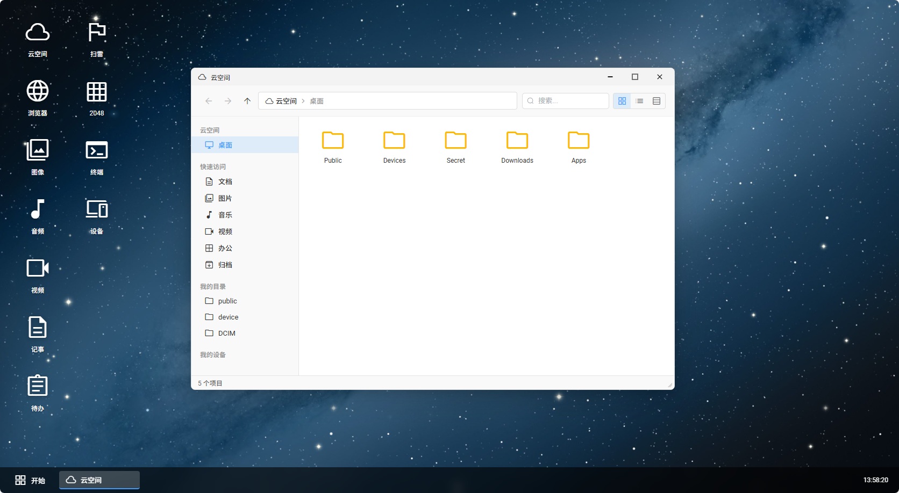
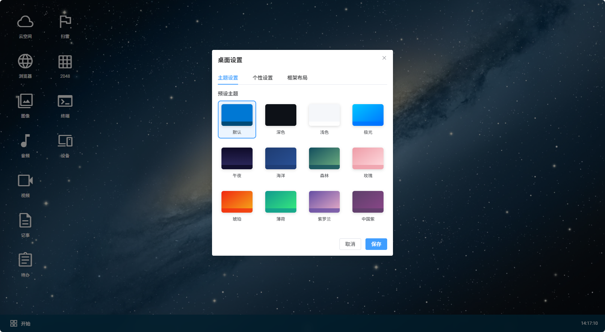
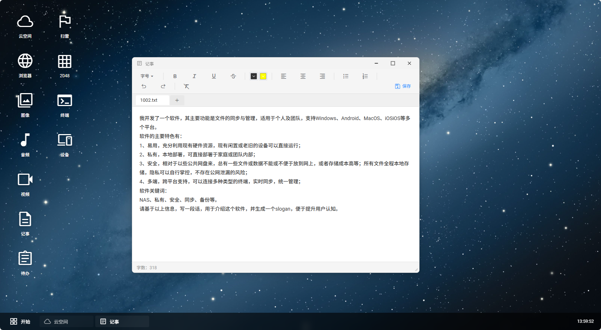
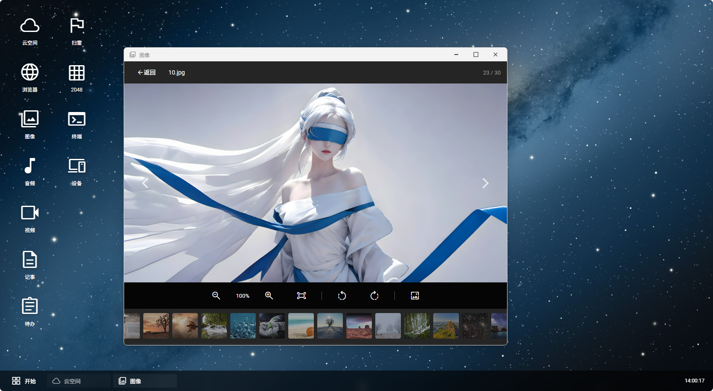
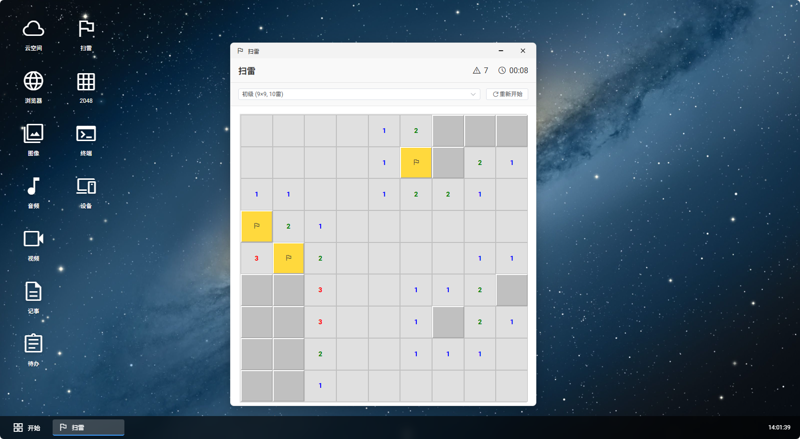
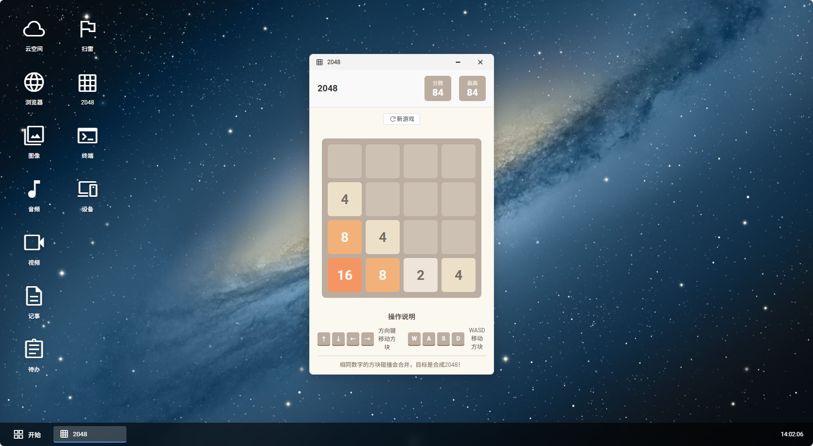
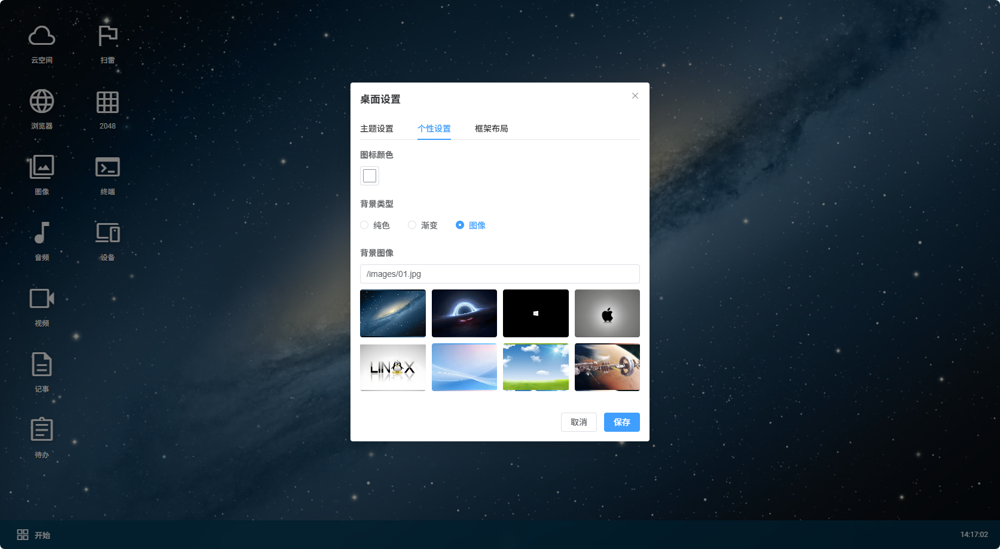
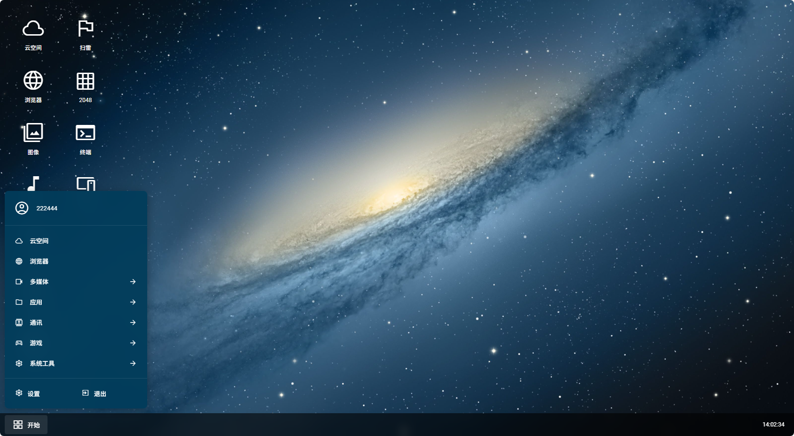

# 我用AI手搓了一套WebOS

> 题记：有时候做东西不需要想清楚“有什么用”，先做出来了，它自然会有自己的位置。

## 一、缘起：为什么要在浏览器里造一个桌面？

做这个 WebOS 的念头来得并不高大上。

我手头有一个基于 Scm.Net 框架的后台项目，前端用的是 Vue 3.5 + Vite 8 + Element Plus 2.13。原本它就是一套标准的中后台管理系统：左侧菜单、顶部导航、标签页、表单表格。用着用着，我突然觉得这种方式很“累”——用户每打开一个功能就要切一次页面，窗口和状态也散在各处。

于是我开始想：能不能把这套系统装进一个“桌面”里？有壁纸、有图标、有窗口、有任务栏，像 Windows 或 macOS 一样，把所有业务功能都变成可自由打开、拖动、最小化、最大化的“应用”。

结果一发不可收拾，最后手搓出了一整套浏览器里的 WebOS。

## 二、技术骨架：Vue 3 + 纯前端，没有花里胡哨

先说一下整体架构，免得大家觉得这是什么黑魔法。

- **核心框架**：Vue 3.5 + Vite 8，纯 JavaScript，没有 TypeScript。
- **组件库**：Element Plus 2.13 做应用内部的内容，但桌面外壳、窗口系统、任务栏这些全是自己写的。
- **窗口管理器**：`src/views/home/desktop/components/Window.vue`，单文件组件，支持拖拽、缩放、最大化、最小化、关闭。
- **桌面壳**：`src/views/home/desktop/index.vue`，负责壁纸、图标、任务栏、开始菜单、右键菜单、Dock、主题调度。
- **应用层**：`src/views/home/desktop/components/apps/` 下面，每个应用一个 `.vue` 文件，动态按需加载。

最核心的一点是：系统中的应用全部来自后端菜单接口。桌面图标、开始菜单里的程序列表、任务栏上的窗口，都基于 `tool.session.get("MENU")` 动态生成。也就是说，这套 WebOS 不是写死的玩具，而是真正能接入业务系统的壳。

## 三、窗口系统：让浏览器学会“多任务”

一个桌面好不好用，窗口管理是灵魂。

我做的窗口系统实现了：

1. **自由拖拽**：按住标题栏任意拖动，超出边界会自动限制。
2. **四角缩放**：右下角有 resize handle，可以拉大拉小。
3. **最大/最小化**：双击标题栏最大化，点击按钮最小化到任务栏。
4. **焦点管理**：点击窗口自动置顶，未激活窗口标题栏变灰。
5. **应用内通信**：窗口里的应用可以通过事件向上通知，比如设置壁纸、修改个人信息。

为了适配不同主题，窗口标题栏一共做了四种风格：

- **现代 Windows 风格**：标题在左，控制按钮在右。
- **经典 Windows 风格（95/98/2000/XP）**：渐变标题栏、复古按钮。
- **macOS 风格**：左侧红黄绿交通灯，标题居中。
- **Mac OS 9 白金风格**：致敬经典，方正按钮，条纹标题栏。

每种风格的按钮尺寸、圆角、阴影、边框粗细都不一样，全部通过 `windowTheme` 数据对象驱动，没有写死 CSS。

上图是默认主题下打开“云空间”的效果，窗口边框、阴影、圆角走的是现代 Windows 路线，但配色和壁纸可以更自由。

## 四、主题系统：这才是最上头的地方

如果说窗口系统是骨架，那主题系统就是这套 WebOS 的脸。

我在 `src/views/home/desktop/index.vue` 里维护了一个 `themes` 数组，目前内置了 **30 多套主题**，大致分为三类：

### 1. 抽象风格主题

这一类不模仿任何具体操作系统，只通过颜色和质感营造氛围。包括：

- 默认（Default）
- 深色（Dark）
- 浅色（Light）
- 极光（Aurora）
- 午夜（Midnight）
- 海洋（Ocean）
- 森林（Forest）
- 玫瑰（Rose）
- 琥珀（Amber）
- 薄荷（Mint）
- 紫罗兰（Purple）
- 中国紫（ChinesePurple）

每个主题都会定义：壁纸类型（纯色 / 渐变 / 图片）、任务栏颜色、菜单颜色、图标颜色、窗口配色。只要切换主题，整个桌面的气质会完全改变。

### 2. Windows 历代主题

这部分是我最花时间的，因为不同 Windows 版本的开始菜单样式差异极大。

- **Windows 95 / 98 / 2000**：经典灰蓝开始菜单，带侧边栏，复古到底。
- **Windows XP**：Luna 蓝双栏开始菜单，带用户头像区域。
- **Windows Vista / 7**：Aero 玻璃效果，任务栏和窗口都带模糊透明。
- **Windows 8**：全屏磁贴开始屏幕。
- **Windows 10**：左侧程序列表 + 右侧磁贴。
- **Windows 11**：居中圆角网格菜单，带搜索和推荐区域。

每个 Windows 主题不只是换壁纸，而是真的复刻了对应版本的开始菜单布局、按钮形态、窗口边框。比如 XP 主题的开始菜单是 Luna 蓝双栏，Win7 主题的任务栏有玻璃反光感，Win11 主题的任务栏图标居中。

### 3. macOS 历代主题

macOS 主题的精髓在 Dock、菜单栏和窗口动画。

- **macOS / macOS Tahoe / Sequoia / Sonoma / Ventura / Monterey / Big Sur**
- **Mac OS X / Leopard / Lion / Yosemite**
- **Mac OS 9**

macOS 主题会显示顶部菜单栏（左上角苹果图标 + 当前应用名 + 右上角时间），底部 Dock 栏，以及 Launchpad 全屏启动台。窗口打开时有弹入动画，最小化时有类似“精灵效果”的缩放动画，全部用 Web Animations API 实现。

macOS 主题下不会显示 Windows 任务栏，而是显示 Dock 和 menubar，应用图标通过 Dock 启动或切换。

## 五、内置应用：不只是换皮，而是真能干活

光有桌面壳没用，里面的应用得能用。

目前 `components/apps/` 下已经做了这些应用：

| 应用 | 功能 |
|------|------|
| 云空间（Files） | 文件管理，支持 Public、Devices、Secret、Downloads 等目录 |
| 记事本（Textpad / Notes） | 富文本编辑、笔记列表、搜索、保存 |
| 图像（Image） | 图片预览、缩略图、全屏查看、缩放、旋转 |
| 音频（Audio） | 音频播放、列表管理 |
| 视频（Video） | 视频播放、全屏模式 |
| 日历（Calendar） | 日程查看、事件管理 |
| 浏览器（Browser） | 内置浏览器、书签管理 |
| 计算器（Calculator） | 基础计算 |
| 扫雷（Minesweeper） | 经典扫雷游戏 |
| 2048（Game2048） | 经典 2048 游戏 |
| 终端（Terminal） | 模拟命令行 |
| 待办（Gtd） | 待办管理、时间提醒 |
| 个人信息（Profile） | 用户资料、头像、密码修改 |
| 设置（Settings） | 主题、壁纸、个性化、框架布局 |

这些应用不是简单的 iframe 嵌套，而是 Vue 组件，能通过事件和桌面壳通信。比如在“设置”里切换主题后，桌面会立即响应；在“个人信息”里修改资料后，开始菜单上的用户名会同步更新。

## 六、壁纸与个性化：背景也能讲故事

壁纸系统支持三种类型：

1. **纯色**：直接选颜色。
2. **渐变**：自定义两个渐变色和方向。
3. **图片**：从预设图片里选，也支持自定义上传。

默认提供 8 张预设壁纸，放在 `public/images/desktop/bg/`。Windows 和 macOS 主题则使用各自的标志性壁纸，比如 WinXP 的蓝天绿地、macOS 的银河沙漠。

壁纸、任务栏、开始菜单、图标颜色、图标大小、图标阴影、图标背景这些细节都可以单独调整，调整后可以保存为个人配置。

## 七、开始菜单：每个主题都有自己的打开方式

因为主题跨度太大，开始菜单不能用一个组件包打天下。我在桌面壳里按主题类型渲染了多种开始菜单：

- **通用开始菜单**：带用户信息、程序列表、底部设置/退出按钮。
- **Windows 经典开始菜单**：95/98/2000 风格，侧边栏显示系统名称。
- **Windows XP 双栏开始菜单**：左侧程序，右侧快捷链接，底部注销/关机。
- **Windows Vista/7 Aero 开始菜单**：玻璃效果，双栏 + 搜索框。
- **Windows 8 全屏磁贴开始屏幕**：大色块磁贴铺满屏幕。
- **Windows 10 磁贴开始菜单**：左侧程序 + 右侧磁贴 + 左侧导航条。
- **Windows 11 居中网格开始菜单**：圆角卡片、搜索、推荐、用户区域。
- **macOS 苹果菜单**：左上角下拉菜单，关于本机、系统设置、Launchpad、关机/注销。

同一个菜单数据源，根据当前主题自动切换呈现形态，这是整个项目里最繁琐但也最有成就感的部分之一。

## 八、我做错了什么、做对了什么

### 做错的地方

1. **一开始把样式写得太散**。早期很多主题样式直接写在 `.vue` 文件的 scoped CSS 里，导致后来加主题时要改很多处。后来改成 `themes` 数据对象 + CSS 变量统一驱动，才算解套。
2. **窗口动画一开始用 transition 做**，卡。macOS 主题的打开/关闭/最小化动画后来改用 Web Animations API，并做了 FLIP 处理最大化/还原，流畅多了。
3. **macOS 最小化还原时出现过“窗口消失”的 bug**。原因是旧动画用了 `fill: forwards` 锁住了状态，新动画开始前没有清理旧动画。后来加了 `cancelElementAnimations` 专门清残留动画。

### 做对的地方

1. **主题数据化**。所有视觉变量都收敛到 `themes` 数组，新增一个主题就是新增一个 JSON 对象，非常容易扩展。
2. **窗口和桌面解耦**。`Window.vue` 只负责窗口本身，不知道自己在哪个主题里；主题通过 props 传进去，逻辑清晰。
3. **应用动态加载**。通过 `import.meta.glob('@/views/**/*.vue')` 按需解析应用组件，不需要手动注册每个应用。

## 九、最后：这不是终点

这套 WebOS 现在能跑、能用、能换主题、能玩游戏、能管理文件。但它还远没到“完成”的状态。

接下来想做的是：

- 把更多后台业务模块封装成桌面应用，比如数据库管理、代码生成、流程设计器。
- 增加应用拖拽排序、桌面图标自由布局。
- 增加多桌面（虚拟桌面）。
- 让窗口支持拖拽吸附到屏幕边缘分屏。
- 增加一套主题编辑器，让用户自己调色、保存自定义主题。

有时候我会想，在浏览器里复刻 Windows 和 macOS 到底有什么意义？后来我想明白了：意义不在于“像”，而在于**把人机交互的熟悉感带到 Web 应用里**。用户不需要重新学习一套后台系统，他们看到桌面、图标、窗口，就知道该怎么用。

而且，能在浏览器里一键切换成 XP 的蓝天绿地，或者 macOS 的银河壁纸，本身就挺酷的，不是吗？

---

*写完这篇的时候，我又切回了 Windows 7 主题，看着 Aero 玻璃效果的任务栏，恍惚间像是回到了十几年前。*
